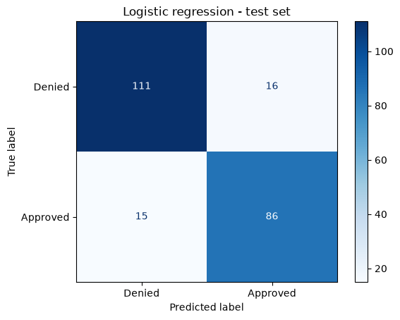

# Credit card approval prediction

A logistic regression classifier that predicts whether a credit card application is approved, built as a scikit-learn pipeline with imputation, scaling, one-hot encoding and a grid search.



## Data

`datasets/cc_approvals.data`: the [Credit Approval dataset](http://archive.ics.uci.edu/ml/datasets/credit+approval) from the UCI Machine Learning Repository (690 applications, anonymised features).

## Key results

- About 86% accuracy and 0.95 ROC AUC on a held-out test set, against a 55.5% majority-class baseline.
- Tuning the regularisation strength makes little difference; the default model is already close to the best this model family does here.
- `PriorDefault` and `Employed` carry most of the signal.

## Running the notebook

```bash
pip install -r requirements.txt
jupyter notebook notebook.ipynb
```
